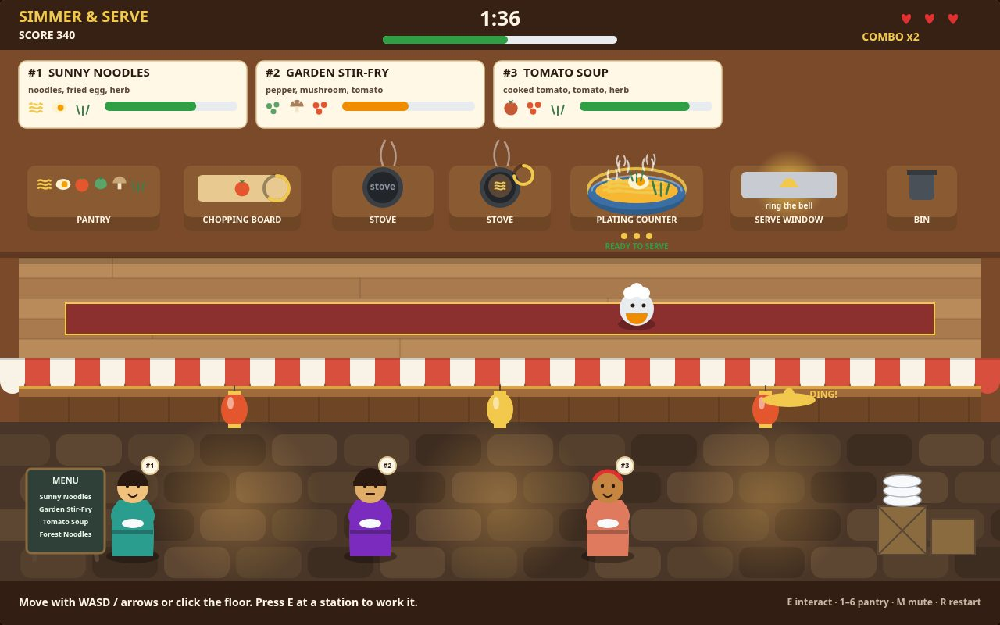
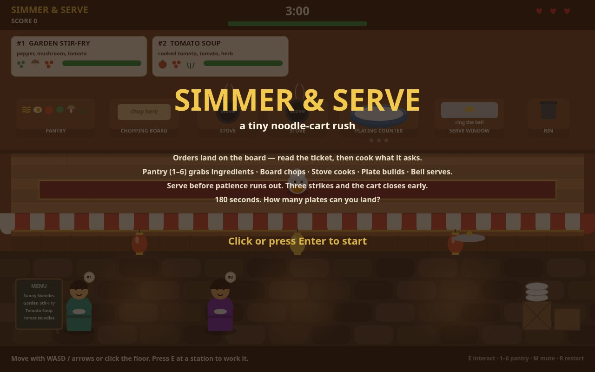
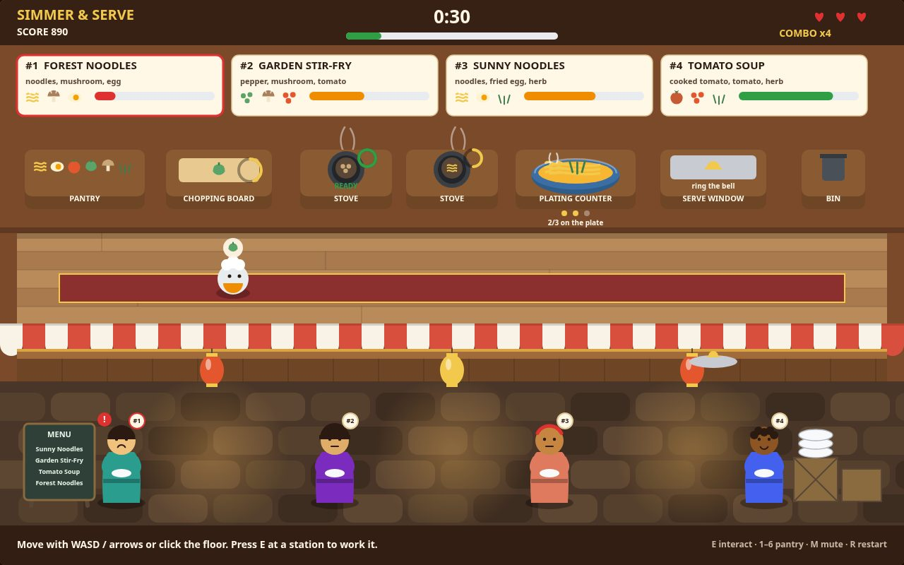
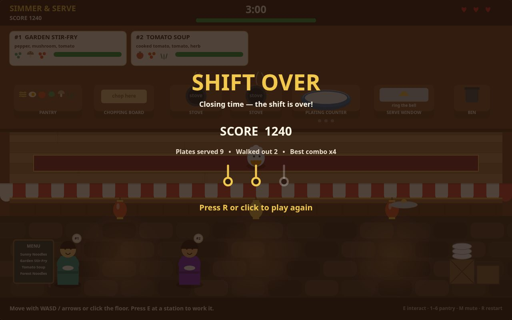

# Simmer & Serve — a tiny noodle-cart rush

A 180-second cooking rush built for the [best-cooking-game-20261125-0137](https://make.fun/competitions/best-cooking-game-20261125-0137) competition on make.fun ($250, top 10).

## The game

You run a tiny noodle cart. Orders land on the board — read the ticket, then cook what it asks. Grab ingredients from the pantry, chop on the board, cook on the stoves, build the plate on the counter, and ring the bell to serve. Serve before patience runs out: three strikes and the cart closes early.

- **4 dishes**: Sunny Noodles, Garden Stir-Fry, Tomato Soup, Forest Noodles
- **6 ingredients**: noodle, egg, tomato, pepper, mushroom, herb — each with its own prep chain (chop, boil, fry, cook; herb is ready as picked)
- **2 stoves** — food left too long burns (4 seconds past done)
- **Scoring**: 100 per plate + up to 50 tip for remaining patience; every 3rd consecutive serve pays ×1.5
- **3 hearts**: an expired order costs one; 0 hearts ends the shift early
- **Rating**: 1–3 ladles (≥900 = 2 ladles, ≥1500 = 3 ladles)

## Controls

| Input | Does |
| --- | --- |
| WASD / arrow keys, or click the floor | Move the cook |
| E or Space (hold E to chop) | Work the nearest station |
| 1–6 | Grab an ingredient from the pantry |
| M | Mute / unmute |
| R | Restart the shift |

## Screenshots

## Play it

Open `game/index.html` in a desktop browser. No build step, no network loads — plain static files plus a little WebAudio synth for sizzles and the serve bell.

## Files

- `game/` — the game: `index.html`, `style.css`, `src/` (one module per job: config, random, kitchen state, cooking, input, audio, render, screenshot staging, main loop)
- `screenshots/` — 4 real renders of the game running in a headless browser
- `main.ts` — hand-in program: copies `game/` + `screenshots/` to `$MAKEFUN_OUTPUT_DIR` and writes `dossier.json` (refuses to run without `MAKEFUN_OUTPUT_DIR`)
- `vendor/makefun-game.ts` — the make.fun dossier library, copied verbatim from the kit

## License

MIT — see [LICENSE](LICENSE).
